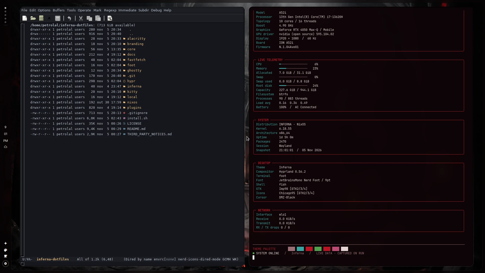
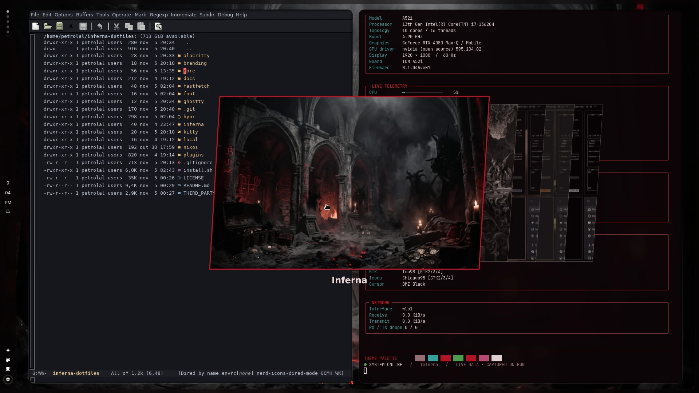
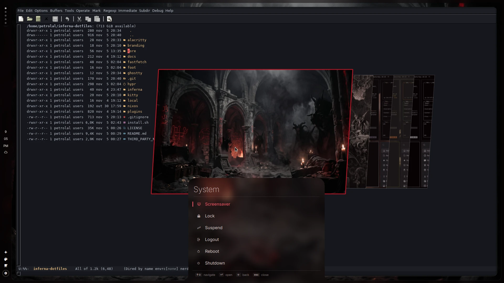
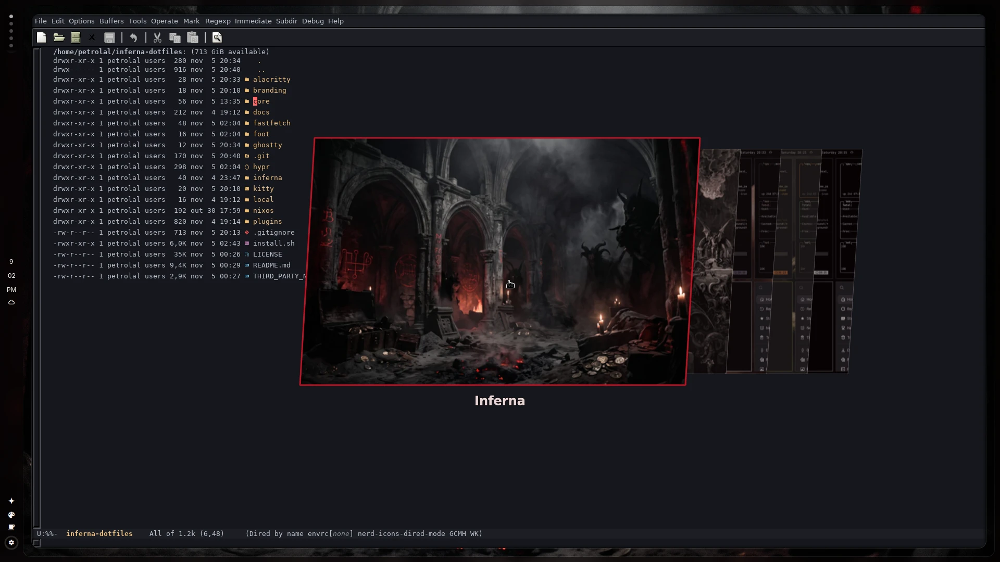
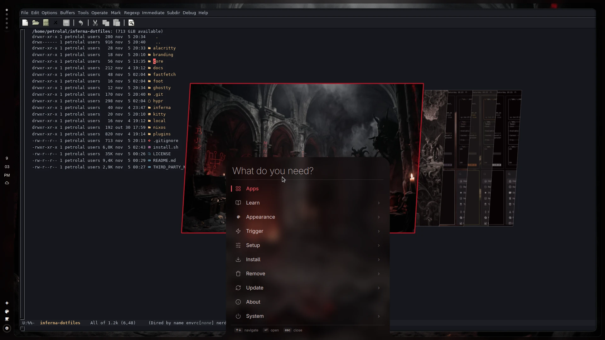

<div align="center">

<h1>inferna-dotfiles</h1>

<p><strong>Pebble Shell & Recessed Windows, engineered natively for NixOS.</strong><br>
A frosted rail that wraps the screen as one surface, a quarter-circle control corner, a search-first menu, recessed windows, fastfetch dashboard, backed by a declarative NixOS Flake.</p>

<p>


<a href="LICENSE"></a>
</p>



</div>

<br>

<table align="center">
<tr>
<td align="center" width="33%"><h3>One surface</h3>Pebble Shell: the left rail and the screen frame are one frosted piece. Drawers and the menu grow out of it instead of floating on top.</td>
<td align="center" width="33%"><h3>Everything close</h3>A quarter-circle corner for brightness, volume, mic and toggles, a search-first menu on Super + Space, and drawers for Wi-Fi, sound, power and more.</td>
<td align="center" width="33%"><h3>Tuned look</h3>Glass and Depth sliders for blur and recessed windows, macOS-style motion, and a theme picker that re-themes everything in one click.</td>
</tr>
</table>

<br>

<table>
<tr>
<td width="50%"></td>
<td width="50%"></td>
</tr>
<tr>
<td width="50%"></td>
<td width="50%"></td>
</tr>
</table>

<p align="center"><sub>
Themes: Inferna (default) and Inferno. A fresh install greets you with INFERNA across the bar, menu, and fastfetch dashboard.
</sub></p>

## What you get

<table>
<tr>
<td width="50%" valign="top"><strong>Pebble Shell.</strong><br>The bar is a rail down the left edge that joins the screen frame, blurred as one surface so there's no seam. Workspaces, clock, weather and tray live in it. High contrast separation border ensures clear distinction against the desktop.</td>
<td width="50%" valign="top"><strong>Control corner.</strong><br>A quarter-circle drawer out of the rail's bottom corner: brightness, volume and mic as arcs, quick toggles, battery and power profile.</td>
</tr>
<tr>
<td width="50%" valign="top"><strong>Search-first menu.</strong><br>Super + Space opens "What do you need?": type to search every Inferna action, or browse Apps, Style, Setup and the rest. It carries your own name as its title.</td>
<td width="50%" valign="top"><strong>Studio drawer.</strong><br>Glass (opacity, blur, backdrop), Depth (recessed or raised windows, tuned for light and dark themes), Tricky Tiles motion and display in one place.</td>
</tr>
<tr>
<td width="50%" valign="top"><strong>fastfetch dashboard.</strong><br>Hardware, live telemetry, system, desktop and network cards with full-width responsive blocks and Inferna ASCII branding.</td>
<td width="50%" valign="top"><strong>Unified Terminals.</strong><br>Cohesive styling across Foot, Kitty, Alacritty, and Ghostty with automated theme color injection.</td>
</tr>
</table>

## Themes

Inferna Dotfiles ships with a focused selection of curated dark themes, complete with bundled default wallpapers, color palettes, and terminal integrations:

1. **Inferna** (Default `#1`)
   - **Aesthetic:** Demonic abyssal blood-crimson and dark obsidian.
   - **Original Inspiration:** Inferna Cathedral Rice.
   - **Palette:** Rich obsidian background (`#0e0507`), arterial crimson accent (`#b81424`), arterial bar separator border, warm ember highlights.
   - **Command:** `inferna theme set "Inferna"`

2. **Inferno** (Secondary `#2`)
   - **Aesthetic:** Volcanic ember and Doom scorched charcoal.
   - **Original Inspiration:** Inferno / Doom Ember.
   - **Palette:** Deep cinder background (`#120c0c`), blazing scarlet accent (`#ff4a36`), and bone ash text (`#ded1c8`).
   - **Command:** `inferna theme set "Inferno"`

3. **Last Horizon**
   - **Aesthetic:** Twilight dusk mauve and atmospheric mist.
   - **Original Inspiration:** Last Horizon by community.
   - **Palette:** Soft mauve accent (`#b59790`), slate backdrop (`#0c0b0c`).
   - **Command:** `inferna theme set "Last Horizon"`

4. **Miasma**
   - **Aesthetic:** Atmospheric moss and earthy olive forest.
   - **Original Inspiration:** Miasma.
   - **Palette:** Earthen olive accent (`#78824b`), warm dark stone (`#222222`).
   - **Command:** `inferna theme set "Miasma"`

5. **Vantablack**
   - **Aesthetic:** Minimalist pure OLED monochrome.
   - **Original Inspiration:** Vantablack.
   - **Palette:** Absolute zero `#000000` pitch black and sharp silver/white contrast (`#ffffff`).
   - **Command:** `inferna theme set "Vantablack"`

Switch themes interactively via `inferna theme-switcher` (Super + Space &rarr; Appearance &rarr; Theme).

## Terminal Setup

Inferna uses **Foot** as the default Wayland-native terminal emulator, configured with JetBrainsMono Nerd Font and padding.

All major modern terminals are first-class citizens and dynamically inherit the active theme colors without hardcoded distro hacks:
- **Foot** (`~/.config/foot/foot.ini`) &mdash; Default
- **Kitty** (`~/.config/kitty/kitty.conf`)
- **Alacritty** (`~/.config/alacritty/alacritty.toml`)
- **Ghostty** (`~/.config/ghostty/config`)

You can set your preferred terminal anytime:
```bash
inferna default terminal <foot|kitty|alacritty|ghostty>
```

## Install on NixOS

This repository is self-contained. It ships with the core shell runtime (`core/`), 28 bundled plugins (`plugins/`), Hyprland depth & glass setup (`hypr/`), and the complete NixOS configuration (`nixos/`).

### 1. Apply NixOS System Configuration

Rebuild and switch to the system configuration:

```bash
cd ~/inferna-dotfiles/nixos
sudo nixos-rebuild switch --flake .#default
```

### 2. Deploy User Dotfiles & Plugins

Run the installer to deploy the shell layout, Hyprland overrides, and Quickshell plugins to `~/.config`:

```bash
cd ~/inferna-dotfiles
./install.sh
```

Everything replaced is safely backed up to `~/.config/inferna-dotfiles-backup/<time>/`.

Then reload Hyprland and start the shell:
```bash
hyprctl reload && inferna restart shell
```

## Make it yours

**Name.** The menu title and the fastfetch heading read one setting. Add this to `~/.config/inferna/extensions/inferna-menu.jsonc`:

```jsonc
{
  "root": { "label": "Pixel", "title": "PIXEL" }
}
```

Without it, both say INFERNA. The fastfetch banner is `~/.config/inferna/branding/about.txt`, so replace that file to change the logo.

**Bar layout.** `~/.config/inferna/shell.json` decides which widgets sit where.

**Look.** Open the Studio drawer in the bar to change glass, depth and motion. Its panels write `hypr/glass.lua` and `hypr/recessed_windows.lua` for you.

## Credits & Attribution

- **Author & Maintainer:** Lucas Petrolal ([@petrolal](https://github.com/petrolal/inferna-dotfiles))
- Upstream shell architecture and design inspired by [omarchy-dotfiles](https://github.com/denonmaryland/omarchy-dotfiles) and [Quickshell](https://quickshell.outfoxxed.me/).
- Core shell plugin foundations originated as part of [Omarchy](https://github.com/basecamp/omarchy) by David Heinemeier Hansson.
- Icons in `denon.menu/icons` and `denon.tray/icons` are from [Lucide](https://lucide.dev) (ISC License).
- Complete third-party notices and license texts: see [THIRD_PARTY_NOTICES.md](THIRD_PARTY_NOTICES.md).

## License

GNU General Public License v3.0 (GPL-3.0-or-later). See [LICENSE](LICENSE).  
Modifications, redistributions, and forks must retain attribution to Lucas Petrolal and link to the original repository (<https://github.com/petrolal/inferna-dotfiles>).
